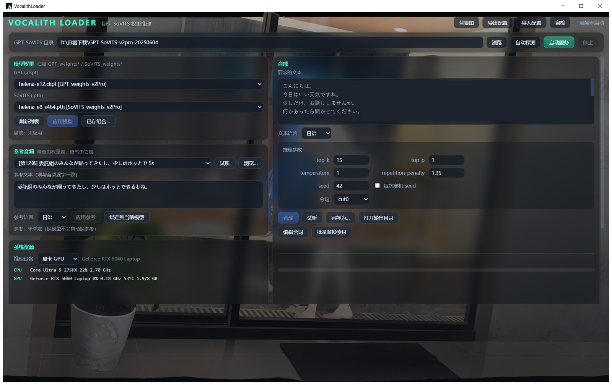

# VocalithLoader

Desktop GUI for zero-shot voice synthesis with GPT-SoVITS.

VocalithLoader wraps the GPT-SoVITS inference pipeline in a desktop window: pick a
model and a reference clip on the left, write the lines on the right, and the history
and logs sit underneath. The inference itself still runs inside GPT-SoVITS — this is
only the layer that makes it comfortable to use.

Windows desktop app. Python + pywebview, the UI is plain local HTML, and nothing in
the program talks to the network. Copy the folder to another machine and it still works.

> **What this repository does not contain:** no model weights, no voice data, no
> training set. VocalithLoader is only the interface — it needs an existing
> GPT-SoVITS installation with your own weights before it can synthesize anything.

**English** · [简体中文](README.zh-CN.md)



---

## Install

Requires Python 3.9+ and the WebView2 runtime (bundled with Windows 10 and 11; grab it
from Microsoft if missing — without it the app refuses to start and the error comes
from pythonnet).

```bash
git clone https://github.com/win11tan/VocalithLoader.git
cd VocalithLoader
pip install -r requirements.txt
python app.py
```

Or double-click `启动.bat`. It checks dependencies, installs anything missing, then
launches `app.py`.

`psutil` and `numpy` are optional. Without them the app still runs; port ownership
detection falls back to system commands and the spectrum bar stays empty.

## What you need first

A GPT-SoVITS portable package — the folder must contain `runtime\python.exe` and
`api_v2.py`. The app searches for it on first launch. If it can't find it, use the
**Browse** button on the "GPT-SoVITS directory" row and pick it manually.

GPU: any NVIDIA card with 3 GB+ VRAM. With a GPU, 377 characters take about 25 seconds.
CPU works as a fallback — the same 377 characters take around 100 seconds, longer on a
four-core laptop. The UI shows whether GPU or CPU is in use; switching requires
restarting the service.

## First run

1. Confirm the GPT-SoVITS directory is correct
2. Click **Start service** and wait for the model to load — the progress bar shows which
   item is loading, usually a matter of seconds
3. Pick the GPT and SoVITS weights from the two dropdowns, click **Apply model**
4. The reference clip is matched automatically to a training sample belonging to that
   model. Hit **Preview** to listen; swap it if it sounds wrong
5. Type the text and click **Synthesize**
6. Results appear in the history — double-click to play, right-click to reveal in folder

## Timbre and delivery are two different things

The SoVITS weights decide the **timbre** — who is speaking. The reference clip decides
the **delivery** — pacing, pauses, emotional contour.

So model A's weights with model B's reference audio gives you A's voice with B's
cadence. Switching models automatically swaps the reference clip to that model's own
training sample, specifically to avoid this clash.

The reference text must match the reference audio word for word. Swap the audio without
updating the text and the timbre quality drops noticeably.

To change delivery, change the reference clip. Training sample filenames carry the
scene, shown in brackets in the dropdown — the same line delivered in different scenes
comes out differently.

Reference clips have a hard length limit. Anything too short is rejected by the service
with a 400. The app measures the duration before submitting and tells you which sample
to switch to.

## About the progress bar

Progress is counted from the output of a service the app started itself, so it's only
accurate for instances the app owns.

If the port is already occupied by a GPT-SoVITS service started elsewhere, clicking
**Start service** asks whether to take over and restart, or to share the existing one.
Sharing still synthesizes, but progress degrades to a character-count estimate. Take
over if you want real numbers.

## What's in the folder

```
app.py                 entry point — window and frontend/backend messaging
engine.py              service process, synthesis, progress, monitoring
core.py                config, logging, disk paths
ui/                    the interface; edit styles here
bg_builtin/            built-in background images
app.ico                program icon
config.example.json    sample of every config field
config.json            live config, machine-specific, not tracked
logs/                  logs — check here first when something breaks
output/                generated audio
启动.bat               double-click this
VocalithLoader.spec    PyInstaller build config
```

## Troubleshooting

**Start service does nothing**
Check `logs\api_err.log`. Usually the GPT-SoVITS directory is wrong, or the port is
taken by another program.

**Synthesis is slow**
Check the bottom-right corner — GPU or CPU? If it says CPU while you have a GPU, switch
it under "Inference device" and restart the service. Three to four times slower on CPU
is normal, not a hang.

**The voice doesn't sound right**
Check three things: are the weights the right character's, do the reference audio and
reference text match, and is the reference clip clean and about five seconds long.
Get any one of them wrong and the timbre drifts.

**The port is still held after closing**
The app shuts down any service it started on exit. If the port is still occupied, that
instance was launched elsewhere — close it from its own window.

## Moving to another machine

Copy the whole folder. If the paths are wrong, re-select the GPT-SoVITS directory or
click **Auto-detect**. The config travels with `config.json`.

## Building an executable

```bash
pip install pyinstaller
pyinstaller VocalithLoader.spec
```

Output lands in `dist\`. The spec already bundles `ui` and `bg_builtin`, and points the
icon at `app.ico` in the project root — replace that file to change the icon.

## Architecture

Three layers, kept separate: `app.py` only touches the window and messaging, `engine.py`
only touches business logic and subprocesses, `core.py` only touches config and disk.

The frontend doesn't call Python business functions directly. Events go into a queue
that the frontend polls every 120 ms. The reason: WebView2's controller is a COM object
that can only be touched on the UI thread — calling it from an engine thread throws an
`InvalidCastException` which gets swallowed, and the symptom is that logs and monitors
simply stop refreshing. Polling removes the cross-thread problem at the root, at the
cost of up to 120 ms of latency.

Most features only need `engine.py` and `ui/app.js`. `app.py` rarely changes.

## Assets and license

The **code** is released under the MIT license — see [LICENSE](LICENSE).

The icon and built-in backgrounds are official character art from the mobile game
*Azur Lane* (characters Helena and Helena META). Copyright belongs to the original
rights holders and is **not** covered by the MIT license. See [NOTICE](NOTICE) for
details. This repository contains no game voice lines, no model weights, and no
training data.

Those assets ship with the repo only so a fresh clone can show a real interface. If you
plan to use this commercially or redistribute it, replace them first: swap `app.ico`,
and delete the images in `bg_builtin/` — the UI falls back to a solid background.

This project has no affiliation with the developers or publishers of *Azur Lane*. It is
unofficial, non-commercial, and free of charge.

## About this project

Built by a high-school student in China who only gets home once a month, so replies to
issues and pull requests can take a while.

AI assistants were used heavily throughout development. The requirements, debugging, and
design decisions are mine, but a fair amount of the code was drafted with AI help. I am
writing this down so you know what to expect: it runs in the setups I have tested, and
beyond that I cannot make promises.

Bug reports and corrections are welcome. If something breaks on your machine, an issue
with your Windows version, GPU, and GPT-SoVITS version will help a lot.
