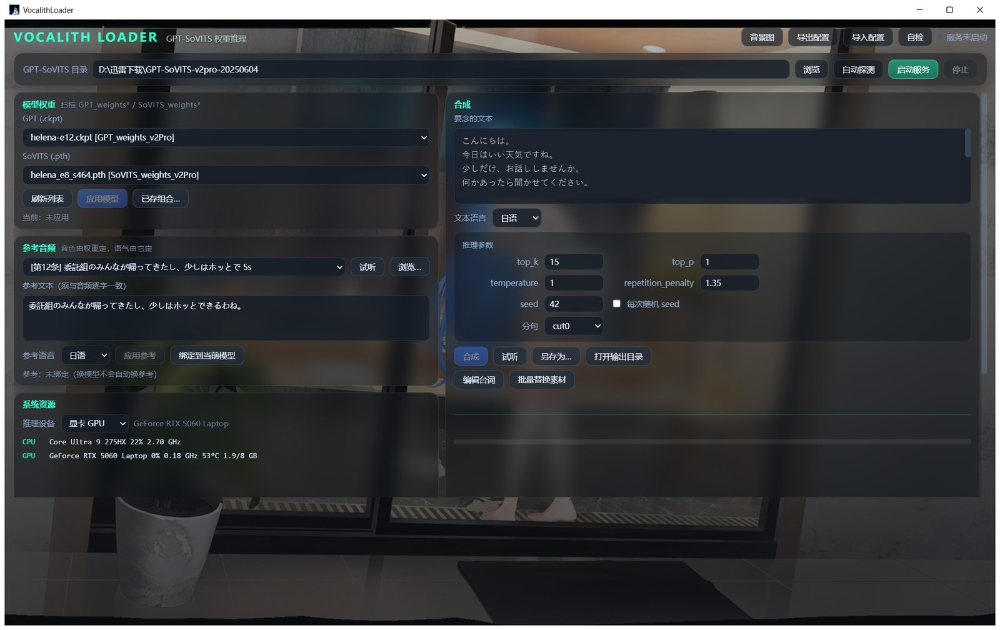

# VocalithLoader

给 GPT-SoVITS 做零样本语音合成的 Windows 图形界面（GUI）。选好权重和参考音频就能出声，
不用开命令行、不用改配置文件。

左侧挑模型和参考音频，右侧写台词合成，底下是历史和日志。推理还是 GPT-SoVITS 自己在跑，
这里只是把用起来顺手的那一层做出来。

Windows 桌面程序，Python + pywebview 起窗口，界面是本地 HTML，没有任何联网组件。
换台机器整个目录拷过去就能用。

> **这个仓库里没有**：模型权重、语音素材、训练数据，一样都没有。
> VocalithLoader 只是界面，必须配上 GPT-SoVITS 和权重才能出声——三个角色的权重
> 单独放在魔搭上，见[语音模型](#语音模型)。

[English](README.md) · **简体中文**



---

## 下载

**[直接下 Windows 版](https://github.com/win11tan/VocalithLoader/releases/latest)**，
34 MB 的 zip。解压到任意位置，双击 `VocalithLoader.exe` 就能开。不用装 Python，不用
装依赖，不写注册表；不想要了删掉文件夹就行。

第一次打开大概率会被 Windows 拦一下，因为这个 exe 没有代码签名，而签名证书是要花钱的。
点「更多信息」→「仍要运行」。不想信任现成的二进制，就走下面的源码方式。

不管走哪条路，都还是需要 GPT-SoVITS 本体和权重。权重不在这个仓库里，见下面的
[语音模型](#语音模型)，以及[需要先准备什么](#需要先准备什么)。

## 语音模型

光有界面出不了声。三个 GPT-SoVITS v2Pro 角色的权重单独放在魔搭上：文件大，授权是
单独一套，塞进这里也会让 clone 变得很重。

| 角色 | GPT 权重 | SoVITS 权重 | 体积 | 下载 |
| --- | --- | --- | --- | --- |
| 海伦娜 Helena | `helena-e12.ckpt` | `helena_e8_s464.pth` | 290 MB | [魔搭](https://www.modelscope.cn/models/HelenaCL50/helena-gpt-sovits) |
| 企业 Enterprise | `enterprise2-e8.ckpt` | `enterprise2_e8_s472.pth` | 290 MB | [魔搭](https://www.modelscope.cn/models/HelenaCL50/enterprise-gpt-sovits) |
| 雪风 Yukikaze | `yukikaze-e12.ckpt` | `yukikaze_e4_s196.pth` | 290 MB | [魔搭](https://www.modelscope.cn/models/HelenaCL50/yukikaze-gpt-sovits) |

GPT 文件放进 `GPT_weights_v2Pro\`，SoVITS 文件放进 `SoVITS_weights_v2Pro\`，
然后在两个下拉里选中就行。它们就是普通的 v2Pro 权重，v2Pro 装好就能直接读。

> **这些是非官方、非商业的爱好者模型。** 训练素材是从游戏《碧蓝航线》里提取的语音。
> 角色声音和游戏音频的权利属于原方，这里没有获得任何授权。模型页只放训练出来的权重，
> 不含任何原音频。仅供个人使用：不要卖，不要打包进付费产品，不要上架应用商店。
> 如果权利人认为某个角色不合适，提个 issue 我会删掉。

代码在这个仓库，权重在那边。那边是外部下载点，不是本仓库的镜像，也不跟着这里同步
发版——新版程序能读旧权重，但某个模型页可能比程序更新得慢。

## 安装

需要 Python 3.9 以上，以及 WebView2 运行时（Win10、Win11 一般自带，没有就去微软官网下。
少了这一步程序开不起来，报的是 pythonnet 那边的错）。

```bash
git clone https://github.com/win11tan/VocalithLoader.git
cd VocalithLoader
pip install -r requirements.txt
python app.py
```

或者双击 `启动.bat`，它会检查依赖，缺了自动装，然后调 `app.py`。

`psutil` 和 `numpy` 缺了也能跑，只是端口归属判断会退回系统命令、频谱条会空着。

## 需要先准备什么

一份 GPT-SoVITS 便携包，目录里要有 `runtime\python.exe` 和 `api_v2.py`。
第一次打开会自动去找，找不到就在「GPT-SoVITS 目录」那一行点「浏览」手动选。

显卡：NVIDIA 独显，显存 3G 以上。有显卡的情况下 377 字大约 25 秒合成完。
没有显卡也能跑，纯 CPU 做兜底，同样 377 字要 100 秒左右，四核老笔记本会更久。
界面显示当前用的是显卡还是处理器，切过去要重启服务才生效。

## 第一次用

1. 确认「GPT-SoVITS 目录」指对了
2. 点「启动服务」，等模型加载完。这时候进度条会显示加载到第几项，十几秒的事
3. 两个下拉里选 GPT 和 SoVITS 权重，点「应用模型」
4. 参考音频会自动按当前模型匹配一条训练样本，点「试听」听一下，不对就换一条
5. 写上要念的文本，点「合成」
6. 出来的音频在历史里双击就能听，右键可以在文件夹里定位

## 音色和语气是两回事

音色由 SoVITS 权重决定，也就是「这是谁在说话」。
语气由参考音频决定，包括语速、停顿、情绪的起伏。

所以 A 角色的模型配 B 角色的参考音频，出来的是 A 的嗓子、B 的腔调。
换模型的时候程序会自动把参考音频换成这个模型自己的训练样本，就是为了避免这种夹生。

参考音频必须和参考文本对得上，文本要是那段音频里原原本本说出的话。
换了音频不换文本，音色会明显变差。

想换语气就换参考音频。训练样本的文件名里带着场合，下拉里用方括号标出来了，
同一句话用不同场合的样本，出来的味道不一样。

参考音频有长度限制，太短会被服务端直接拒绝（400）。程序在提交前会先算一遍时长，
不合格会告诉你该换哪一条。

## 关于进度条

进度是从程序自己启动的服务输出里数出来的，所以只有程序自己拉起来的服务才准。

如果端口上已经有一个不是这里启动的 GPT-SoVITS 服务，点「启动服务」会问你
「接管并重启」还是「先共用着」。共用能合成，但进度只能按字数估算，
想要准确的进度就选接管。

## 目录里都有什么

```
app.py                入口，负责开窗和前后端通信
engine.py             业务逻辑，管服务进程、合成、进度、监控
core.py               数据层，配置读写、日志、路径
ui/                   界面文件，改样式的话在这里
bg_builtin/           内置的几张背景图
app.ico               程序图标
config.example.json   配置字段样例，照它手填也行
config.json           实际配置，运行时生成，跟机器绑定，不进版本库
logs/                 日志，出问题先看这里
output/               生成的音频
启动.bat              双击这个
VocalithLoader.spec   PyInstaller 打包配置
```

## 出问题先看这里

**点了启动服务没反应**
看 `logs\api_err.log`。多半是 GPT-SoVITS 目录选错了，或者端口被别的程序占着。

**合成很慢**
先看右下角是显卡还是处理器。有显卡却写着处理器，在「推理设备」那里切过去，
然后停掉服务重新启动。CPU 上慢三到四倍是正常的，不是卡住。

**声音不像**
检查三件事：权重是不是这个角色的、参考音频和参考文本对不对得上、
参考音频有没有五秒左右且干净。三条里错一条音色就会走样。

**关掉程序之后端口还占着**
程序退出时会把自己拉起来的服务一并关掉。如果还占着，说明那是别处启动的，
去它自己的窗口里关。

## 换机器

把整个文件夹拷过去就行。目录不对就在「GPT-SoVITS 目录」那里重新选一次，
或者点「自动探测」让它自己找。配置会跟着 `config.json` 一起走。

## 打包成 exe

```bash
pip install pyinstaller
pyinstaller VocalithLoader.spec
```

产物在 `dist\` 里。spec 已经把 `ui` 和 `bg_builtin` 一起打进包，
图标指向项目根的 `app.ico`，改图标就改那个文件。

## 项目结构与约定

三层分得很清楚：`app.py` 只碰窗口和消息，`engine.py` 只碰业务和子进程，
`core.py` 只碰配置和磁盘。

前端不直接调 Python 业务函数，走 Bridge 轮询。原因是 WebView2 的控制器是 COM 对象，
只能在 UI 线程碰，从引擎线程调用会抛 `InvalidCastException`，异常被吞掉之后
表现就是日志、监控全都不刷新。改成轮询之后跨线程问题从根上没了，
代价是最多 120 毫秒的延迟。

想加功能一般动 `engine.py` 和 `ui/app.js` 就够，`app.py` 很少需要改。

## 素材与许可

代码以 MIT 许可证发布，全文见 [LICENSE](LICENSE)。

图标和内置背景用的是《碧蓝航线》里海伦娜及海伦娜·META 的官方立绘，
版权归原权利人，**不属于** MIT 授权范围，详细说明见 [NOTICE](NOTICE)。
本仓库不含任何游戏语音、模型权重或训练数据。

这些素材随仓库分发只是为了让人克隆下来就能跑起来看界面。如果要商用或再分发，
请先把它们换掉：图标改 `app.ico`，背景删掉 `bg_builtin/` 里的图，界面会退回纯色底。

本项目与《碧蓝航线》的开发方、发行方没有任何关系，非官方、不商用、不收费。

## 关于这个项目

本人是高中生，住校，一个月才放一次假回家，所以 issue 和 PR 的回复会比较慢。

开发过程中大量使用了 AI 辅助。需求、调试和设计判断是我自己做的，但相当一部分代码
由 AI 起草。这点如实写出来，方便你判断能指望它到什么程度——在我测过的环境里能跑，
别的环境不敢保证。

发现问题欢迎提 issue，能改的我会改。如果在你机器上跑不起来，告诉我 Windows 版本、
显卡型号和 GPT-SoVITS 版本，会好排查很多。
